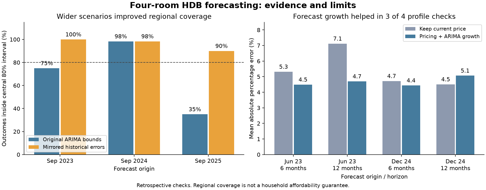

# Forecasting final review — 19 October 2026

The four-room forecasting component is ready for handover. It includes the saved
regional model, callable inference, town robustness checks, model diagnostics,
LSTM lag explanations, joint market scenarios and a real-data replay through
Daniel's solver. Final dashboard adoption of the new scenario model remains an
integration task; the existing point-model export has not been silently replaced.

## What the forecasting component does

1. Build monthly, characteristic-adjusted price indices from HDB resale transactions.
   Area, remaining lease and its square, storey, town, flat model, MRT distance and
   amenity controls help separate changes in the flats sold from market movement.
2. Fit forecasting candidates to the log index. Compare last-value naive, seasonal
   naive, ARIMA(0,1,1) with drift, seasonal ARIMA, each statistical model with lagged
   SORA where applicable, and a pooled LSTM.
3. Select one family using earlier expanding-window validation. Refit that family
   on January 2017–September 2026 for October 2026–September 2027 inference.
4. Multiply the pricing lead's same-date profile valuation by regional growth factors.
   Forecasting supplies market movement; pricing supplies differences between flats.
5. Supply optional joint scenarios so all profiles experience a coherent market
   scenario instead of drawing unrelated shocks for each town and future month.

Scope is **4 ROOM only**, across five regions. A single regional growth factor
does not predict block-specific appreciation. Other flat types in the optimiser
remain outside the trained forecasting component.

## Model selection and splits

Training always precedes evaluation. At each origin, refit the hedonic index with
training transactions and freeze its attribute coefficients for evaluation.
LSTM input/output scaling and sequence construction use training data only.
SORA uses lagged observations and a flat last-known future-rate assumption.
See [EVALUATION.md](EVALUATION.md) for exact dates and metric definitions.

| Candidate | Earlier validation MAPE | Later-year check MAPE |
|---|---:|---:|
| ARIMA(0,1,1) + drift | **1.43%** | 3.41% |
| ARIMA + SORA | 1.45% | 3.31% |
| SARIMA | 2.16% | 1.75% |
| SARIMA + SORA | 2.31% | 1.82% |
| Pooled LSTM | 1.99% | 3.74% |
| Last-value naive | 3.68% | **0.83%** |
| Seasonal naive | 7.49% | 1.62% |

ARIMA remains the deployed family because it won the specified earlier validation
criterion. It did not win the later year or every region. The later period has
already been inspected, so it is a later-period check, not an untouched final test.
MAPE is average absolute percentage error; it is not valid to describe 1.43% MAPE
as “98.57% accurate.” These are regional-index errors, not individual-flat errors.

The LSTM is a recurrent neural network with memory gates: 12 past monthly log
changes enter one 16-unit LSTM and a linear layer predicts 12 cumulative future
changes. Five regions are pooled; three fixed seeds are averaged. It uses no
explicit SORA or amenity inputs. Its nonlinear capacity did not improve average
validation accuracy over ARIMA in this small monthly sample.

## Requested town checks

All three towns have 117 observed months. Minimum monthly four-room sales were
19 in Sengkang, 7 in Hougang and 3 in Ang Mo Kio, making sparse local estimates a
particular concern in Ang Mo Kio. Regional and local competitors use the same
frozen-adjustment town target for a fair comparison.

| Town | Local ARIMA validation | Regional ARIMA validation | Regional ARIMA later check | Naive later check |
|---|---:|---:|---:|---:|
| Sengkang | 1.71% | 1.94% | 2.99% | 0.60% |
| Hougang | 1.74% | 1.99% | 3.19% | 0.83% |
| Ang Mo Kio | 2.23% | 2.85% | 2.70% | 1.33% |

Local models are a plausible future extension, but these exploratory results do
not justify switching the delivered model after inspecting its evaluation period.
The structural-controls-only ablation retained the same model-family ranking.
It uses a different adjusted target, so its MAPE cannot establish that amenity
controls causally improve accuracy.

## Uncertainty and joint Monte Carlo

The error bank contains 21 quarterly-origin, fully realised 12-month paths across
all five regions. One draw selects an entire 12 × 5 error matrix, retaining
empirical dependence across regions and horizons. Profiles in the same region
share market growth. Repeated draws do not create new historical evidence; the
origins overlap and are not 21 independent market cycles.

At every historical calibration date, only error paths whose full 12-month outcome
was already observable are eligible. A future-outcome perturbation test checks this.

Two variants were evaluated. Directional resampling retains historical errors as
observed and performed poorly when historical bias did not persist. Symmetric
resampling mirrors the entire matrix with a common positive/negative sign; this
assumes error-sign symmetry and creates 42 possible historical/mirrored paths.

| Forecast origin | Original central-80% coverage | Directional-error coverage | Symmetric-error coverage | Original / symmetric mean width |
|---|---:|---:|---:|---:|
| September 2023 | 75.0% | 36.7% | 100.0% | 5.19% / 11.89% |
| September 2024 | 98.3% | 48.3% | 98.3% | 5.22% / 10.98% |
| September 2025 | 35.0% | 1.7% | 90.0% | 5.26% / 10.39% |

Each row contains 60 correlated region-month observations. Wider symmetric bands
improved these regional checks, but often overcovered and remain exploratory.
They do not establish a 90% household affordability guarantee. A central 80%
interval is p10–p90; a central 90% interval is p5–p95.

The bridge supplies Daniel's Monte Carlo result columns. Availability uses his
supplied cumulative matching-transaction probabilities, with the same arrival
draw at 6 and 12 months so an arrival by month 6 also counts by month 12.
Availability is assumed independent of market shocks and between profiles.
This assumption is not estimated from the data; recorded transactions do not
prove a buyer could access a listing or successfully purchase it.

## Pricing-to-forecast checks

Two real historical pricing exports from Comane were multiplied by dated regional
growth factors and compared with later matched transaction medians. Targets use
origin lease/MRT profiles and a three-month window around each horizon.

| Pricing origin | Horizon | Matched / available profiles | Keep-current-price MAPE | Pricing × ARIMA MAPE |
|---|---:|---:|---:|---:|
| June 2023 | 6 months | 389 / 493 | 5.32% | 4.49% |
| June 2023 | 12 months | 409 / 493 | 7.12% | 4.70% |
| December 2024 | 6 months | 409 / 492 | 4.72% | 4.44% |
| December 2024 | 12 months | 398 / 492 | 4.51% | 5.07% |

Forecast growth improved three of four aggregate checks. Symmetric p90 coverage
at profile level ranged from 82.0% to 94.5%; regional uncertainty alone does not
capture all valuation/profile errors. These checks inherit limitations of the
historical pricing exports, including current feature vintages and annual
outlier processing. Missing profile matches are reported, not counted as success.



## Actual optimiser replay

Daniel's latest fetched commit was `6b238edb594fa4a6bbe33b031c8170e6bea251bf`.
Its new tests concern integer-programming scaling and hedonic residuals; they did
not change the forecasting interface. The real solver was executed in an isolated
copy, using existing shared-folder rental/location inputs and committed geocodes.
Source hashes and transformations are in `evidence/final/replay_sources.json`.

There were **99 solver runs**: 11 quarterly origins from December 2022 to June
2025 × three fixed household scenarios × three forecast-bound alternatives.
Every scenario requests five distinct-town four-room recommendations. The solver
returns fewer where too few towns pass its constraints.

| Forecast-bound alternative | Returned / requested picks | Matched later picks | Within budget among matched |
|---|---:|---:|---:|
| No price change, no forecast buffer | 143 / 165 | 135 | 40.7% |
| ARIMA, original bounds | 111 / 165 | 105 | 80.0% |
| ARIMA, symmetric historical bounds | 92 / 165 | 90 | 93.3% |

The wider alternative returned fewer recommendations. Both ARIMA alternatives had
84 matched picks within budget; 93.3% versus 80.0% reflects different selected
sets, not proof of improved forecast accuracy. Empty/partial shortlists are saved
in the runs and summary files. Repeated households/origins are dependent.

Historical rent and hedonic coefficients are dated; current learned MRT coefficient
corrections are disabled in this reconstruction. The replay uses Daniel's dated
median-price profiles/interim hedonic and transaction-count availability stub.
It does not reproduce the final Comane/conjoint/survival/dashboard combination.
The separate historical pricing test above covers Comane's exported prices.

An integration issue was verified: `fcast_override` alone does not recompute
deterministic `price_upper` in the tested optimiser. The replay injects the dated
forecast through `load_inputs` and asserts that each selected upper price equals
the supplied upper growth factor × base price. The actual Monte Carlo summarizer
also accepted the joint-scenario result schema in a separate synthetic smoke test.

## Diagnostics, explanations and leakage limits

Ljung–Box lag-12 tests reject uncorrelated residuals at 5% in four of five regional
ARIMA fits. ARIMA is therefore an empirically selected prototype, not a fully
adequate white-noise-residual model. ARCH tests at six lags did not reject at 5%
in these fits; this sample does not provide strong evidence to add GARCH simply
to increase the number of techniques used.

The LSTM explanations use permutation-sampled interventional Shapley values for
12 lag inputs at 6-/12-month horizons, with training-only background windows.
Additivity checks passed. These explain which past price changes move the LSTM
prediction relative to its reference history. They do not validate economic
causality or signs of amenity/SORA effects, because those are not LSTM inputs.
Correlated lags and finite permutation sampling limit attribution interpretation.
Method reference: [Lundberg and Lee, 2017](https://arxiv.org/abs/1705.07874).

Implemented protections cover future transaction prices/attributes, train-only
LSTM windows/scaling, unknown categories, dated rates, fully observed calibration
paths, runtime inference and forecast/base-price date alignment. Two unsupported
future flat-model observations at the September 2020 WEST origin were explicitly
excluded from evaluation; counts are in `category_support.csv`.

Remaining limitations include current amenity/block snapshots, current data
revisions, historical publication delays, current rail geometry and retrospective
specification selection. Future lease/profile transitions, individual-flat
valuation error and causal MRT announcement effects are not fully modelled.
Do not describe the full pipeline as completely free of all look-ahead bias.

## How this links to the semester

| Lecture material | Application in this project |
|---|---|
| CPMF Day 4, Seasonal ARIMA and ARIMAX | Differencing/log index, ARIMA/SARIMA, lagged SORA regressors, residual diagnostics and out-of-time comparison |
| CPMF Day 4, ARCH/GARCH | Test for residual variance dependence; report why GARCH was not automatically added |
| CPMF Day 3, Deep learning with PyTorch | Pooled LSTM sequence model, fixed architecture, training-only scaling and benchmark evaluation |
| ACE Day 1, XAI Machine Learning Explainability | Shapley lag attribution and limits of interpreting correlated features |
| PPA Day 2, Predictive to Prescriptive | Pass forecasts and uncertainty into affordability decisions and evaluate the selected profiles |
| ACE Day 3, Salesforce Goal Programming | Daniel's dollar-valued goal deviations and constrained recommendation; forecasting supplies dated growth factors |

The exact joint historical-error simulator is a project design choice connecting
forecasting and simulation, rather than a claim that this precise algorithm was
taught verbatim. Conjoint preference estimation, transaction pricing and survival
modelling remain the respective teammates' model responsibilities.

## Handover and reproduction

Start with [REGIONAL_HANDOVER.md](REGIONAL_HANDOVER.md). Runtime files are
`regional_api.py`, `joint_scenarios.py`, `optimisation_bridge.py`, the saved regional
manifest and `models/regional/joint_errors.json`. Trusted PKLs remain available
for statistical-model audit; the point inference API reads portable JSON.
The bridge's historical helper also needs the committed historical-error evidence.

The existing `outputs/price_paths.csv` remains nominal marginal quantiles. The
new candidate table is `evidence/final/price_forecast_joint_candidate.csv`.
Daniel must opt in to both the candidate bounds and the joint simulator if he
wants the new uncertainty method throughout the UI; changing a CSV alone does
not replace his Monte Carlo engine. No team branch or UI source was edited.

From repository root, with the forecasting environment installed:

```powershell
python -m forecasting.final_validation
python -m forecasting.joint_scenarios
python -m forecasting.explain_forecasts
python -m forecasting.optimisation_bridge
python -m forecasting.pricing_forecast_backtest
python -m forecasting.plot_final_review
python -m unittest discover -s forecasting -t . -p "test_*.py"
```

The explanation step also requires PyTorch and previously generated LSTM
checkpoints. Raw-feature experiments require the team's raw inputs and the
isolated features created by `build_location_inputs`; these are not bundled into
the runtime model. See the earlier README and benchmark instructions.

Optional full optimiser replay requires `requirements-integration.txt`, a local
`git archive` of the documented optimisation commit at
`forecasting/outputs/optimisation_latest.zip`, and the existing shared dataset
folder. It reconstructs all outputs beneath `forecasting/outputs/team_replay/`:

```powershell
python -m forecasting.prepare_team_replay --shared-data "PATH_TO_2. Datasets"
python -m forecasting.check_optimisation_integration
python -m forecasting.replay_optimisation
```

Create the snapshot with `git archive --format=zip
--output=forecasting/outputs/optimisation_latest.zip
6b238edb594fa4a6bbe33b031c8170e6bea251bf optimisation` (one terminal line), after
fetching the optimisation branch. The snapshot and reconstructed input tables are
local generated files, excluded from this handover commit.

Verification: all 17 forecasting tests passed on 19 October 2026; the unchanged
actual solver reached an optimal solution in the five-town synthetic contract
check; all 99 real-data replay invocations completed, including explicitly
recorded empty/partial shortlists. The review figure was visually inspected.

Forecasting work to hand over is complete at the prototype scope above. Remaining
group work is to wire the opt-in scenarios into the final application, reconcile
the final pricing/preference/availability versions, and use these qualified
results in the report and presentation. A pristine future test will require
waiting for outcomes beyond September 2026.
